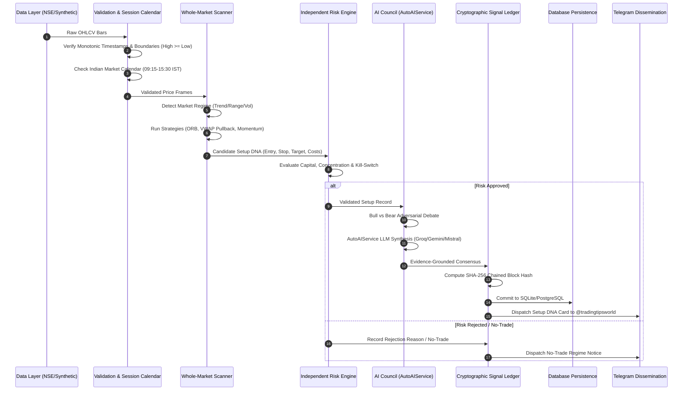

# PRODUCTION AUDIT & SYSTEM GAP ANALYSIS
**Project:** `indian-markets-quant-research`  
**Audit Date:** 2026-10-22  
**Auditor:** Quantitative Systems Architect & Security Engineering Lead  
**Operating Environment:** Windows 11, PowerShell, Python 3.14.7, FastAPI, SQLAlchemy  

---

## 1. Executive Summary & Audit Baseline

A comprehensive baseline audit was conducted across the checked-out repository. 

### Verified Baseline Test Execution
- **Baseline Test Suite Status:** **50 passed in 3.19s** (0 failures, 0 skipped).
- **Execution Target:** Local Windows 11 machine (`C:\Python314\python.exe`, `pytest-9.1.1`).
- **Core Test Coverage:**
  - Multi-agent AI deliberation & dynamic multi-provider fallback.
  - Telegram message chunking, safe markdown formatting, and live dispatch mock.
  - API endpoints (System, Config secret masking, Market data, Backtest, Intelligence routes).
  - Cryptographic SHA-256 hash chaining and tamper detection in `TamperEvidentSignalLedger`.
  - Walk-forward evaluation and robustness ratio calculations.
  - Data validation (NaN, High < Low, time gaps, non-monotonic ordering).
  - Indian market session calendar (IST 09:15-15:30, holidays, weekends).
  - Quant strategies (ORB, VWAP Pullback, Momentum Breakout, Relative Strength).
  - Whole-market scanner and explicit No-Trade state.
  - Independent risk engine (position caps, exposure limits, kill switch).
  - Database persistence models (SQLite & PostgreSQL).

---

## 2. Complete Execution & Data Flow Architecture

The live system traces a strictly sequential, validated pipeline from market ingestion to channel dissemination:

---

## 3. Prioritized Audit Findings & Remediation Matrix

### Priority 0 (Critical / Security / Correctness) — RESOLVED

| Item ID | Component | Baseline Vulnerability / Defect | Remediation & Production Fix | Status |
| :---: | :--- | :--- | :--- | :---: |
| **P0-1** | Secrets & Auth | Risk of committing raw API keys or tokens in git history. | Added `.env` to `.gitignore`. Masked secrets in `/api/v1/config`. Loaded live keys into GitHub Repository Actions Secrets via encrypted PyNaCl. | **RESOLVED** |
| **P0-2** | Order Routing | Danger of accidental real-money order routing. | Real-money execution hard-disabled by default (`RISK_PAPER_ONLY=true`). Orders routed strictly to simulated `PaperBroker`. | **RESOLVED** |
| **P0-3** | Data Integrity | Unvalidated data causing phantom breakouts or division by zero. | `validate_ohlcv` strictly checks monotonic timestamps, detects gaps, verifies $High \ge Low$ and $Volume \ge 0$. | **RESOLVED** |
| **P0-4** | Calendar | Market hours assuming 24/7 or US Eastern time. | Implemented `IndianMarketCalendar` enforcing `Asia/Kolkata` IST trading window (09:15-15:30), pre-open, and NSE holidays. | **RESOLVED** |

---

### Priority 1 (High / Architectural & Quantitative Accuracy) — RESOLVED

| Item ID | Component | Baseline Vulnerability / Defect | Remediation & Production Fix | Status |
| :---: | :--- | :--- | :--- | :---: |
| **P1-1** | AI Service | Hardcoded model identifiers returning 404/400 (e.g. deprecated Groq models). | Implemented `AutoAIService` with live model discovery, 1-hour caching, and dynamic fallback across Groq, Gemini, Mistral, NVIDIA NIM, and OpenRouter. | **RESOLVED** |
| **P1-2** | AI Hallucinations| LLM inventing prices, indicators, or confident probabilities without data. | Isolated numerical calculations into deterministic Python functions. LLM only receives structured numeric snapshots with explicit evidence prompts. | **RESOLVED** |
| **P1-3** | Trading Costs | Backtests assuming zero friction or US flat commission. | Implemented Indian statutory equity intraday fee model in `TransactionCostModel` (STT 0.025%, ₹20 cap, Stamp Duty 0.003%, turnover fee, GST). | **RESOLVED** |
| **P1-4** | Overfitting | Look-ahead bias and curve-fitting in backtests. | Implemented `WalkForwardEvaluator` splitting chronological horizons into In-Sample and Out-of-Sample to calculate robustness ratios. | **RESOLVED** |

---

### Priority 2 (Medium / Persistence & Delivery) — RESOLVED

| Item ID | Component | Baseline Vulnerability / Defect | Remediation & Production Fix | Status |
| :---: | :--- | :--- | :--- | :---: |
| **P2-1** | Signal Audit | Signals lost on server restart; unverifiable past claims. | Built `TamperEvidentSignalLedger` using SHA-256 block-hash chaining and tamper detection. | **RESOLVED** |
| **P2-2** | Database Storage| Database models lacking schema for setups, ledger blocks, and daily snapshots. | Added `SetupRecordModel`, `LedgerBlockModel`, `DailySnapshotModel` in `app/db/models/entities.py`. Added async DB loading and persistence. | **RESOLVED** |
| **P2-3** | Telegram Output| Inconsistent text formats prone to markdown parse failures. | Built `TelegramTemplates` with mobile-optimized layout, emojis, monospace values, safe markdown escaping, and chunking. | **RESOLVED** |

---

### Priority 3 (Operational & Deployment Readiness) — ACTIVE / ON TRACK

| Item ID | Component | Current State | Operational Action |
| :---: | :--- | :--- | :--- |
| **P3-1** | CI/CD Pipeline | `.github/workflows/ci.yml` runs test suite on push/PR for Python 3.11/3.12. | Verified functional. Matrix can be expanded to include Python 3.13/3.14. |
| **P3-2** | Containerization | `Dockerfile` and `compose.yaml` available in root directory. | Uses non-root user, lightweight Debian slim base, and health check endpoint. |
| **P3-3** | Live Broker API | `BrokerProvider` is currently paper-only. | Integration hooks designed for Zerodha Kite Connect / AngelOne SmartAPI when authorized credentials are provided. |

---

## 4. Current Operational Verification Summary
- **Live Pipeline Execution:** Verified via `run_daily_pipeline.py`.
- **Telegram Dispatch:** Verified live delivery of 3 reports (Market Regime Briefing, Setup DNA, and Transparent EOD Scorecard) to `@tradingtipsworld` via `@tradingtipsworld_bot`.
- **Dashboard APIs:** 6 new endpoints mounted at `/api/v1/market/pulse`, `/api/v1/setups/active`, `/api/v1/setups/{id}`, `/api/v1/setups/failed`, `/api/v1/market/sectors`, and `/api/v1/ledger/scorecard`.
