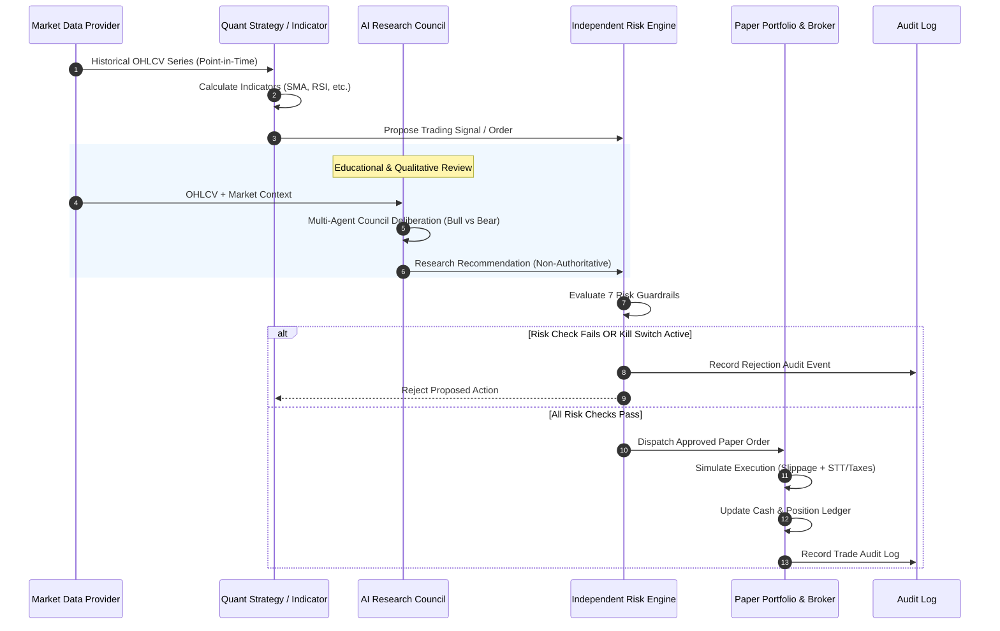

# Data Flow & Decision Process

## 1. End-to-End Decision Lifecycle

The architecture maintains strict boundaries across 5 sequential gates:

## 2. Temporal Isolation (Anti-Lookahead Policy)

1. **Step-by-Step Backtest Progression:**
   The backtest loop iterates chronologically over bar index $i \in [0, N-1]$. Indicator calculations and decisions at bar $i$ can only access data from $[0, i]$.
2. **Execution Timing:**
   Signals triggered at the close of bar $i$ are filled at either:
   - Bar $i$ close + simulated slippage buffer, or
   - Bar $i+1$ open price.
3. **No In-Sample Contamination:**
   Research council and strategy parameter tuning are separated into walk-forward validation windows.
