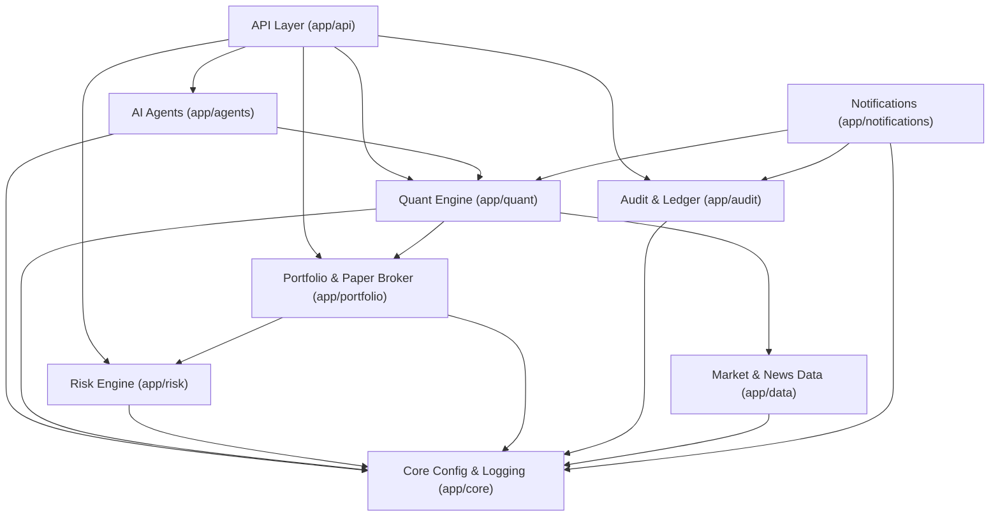

# Module Dependencies and Layering Rules

---

## Architectural Rules

1. **Strict Dependency Unidirectionality:**
   Lower layers (`app/core`, `app/data`) must NEVER import from higher layers (`app/agents`, `app/api`).
2. **Independent Risk Isolation:**
   `app/risk` does not import from `app/agents`. AI agents cannot influence risk engine rules or thresholds.
3. **Paper Trading Isolation:**
   `app/portfolio` contains only simulated paper execution. It does not import or contain any live order execution broker adapters.
4. **Data Neutrality:**
   `app/data` implementations provide standardized `pd.DataFrame` and `Instrument` objects regardless of whether data originates from synthetic generators, historical CSVs, or future live broker websockets.
