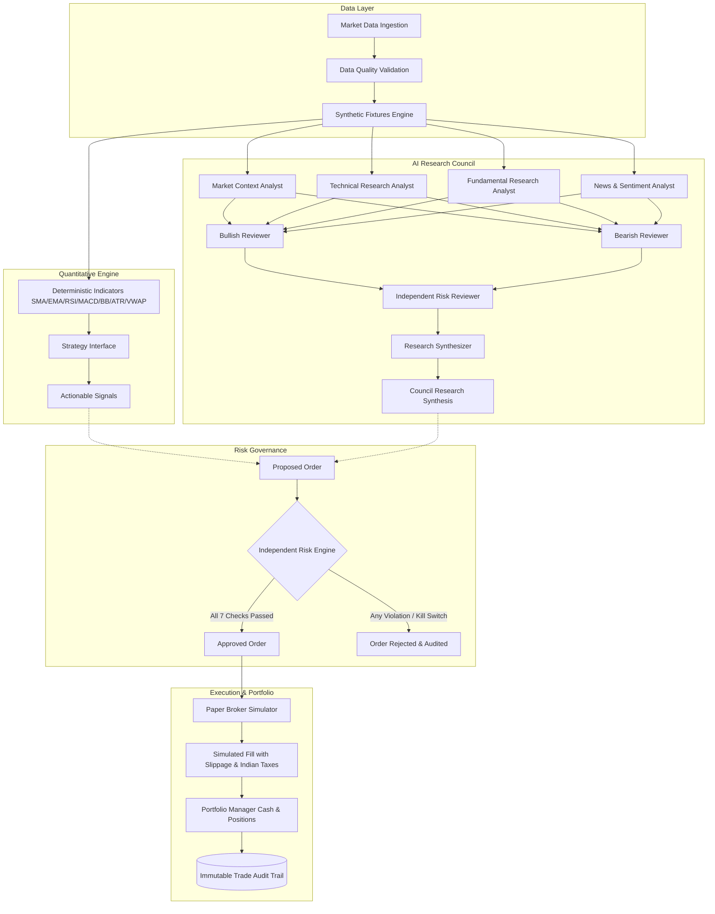

# System Architecture Document

## 1. High-Level Architecture Overview

The **AI Quant Trading Platform** is engineered as a **Modular Monolith** designed for Indian financial markets (NSE/BSE) with multi-market extensibility. It cleanly separates:
1. Market Data Ingestion & Quality Validation
2. Quantitative Feature & Indicator Computation
3. Deterministic Strategy Formulation
4. Anti-Lookahead Historical Backtesting
5. AI Multi-Agent Research Council
6. Independent Risk Governance Engine
7. Paper Trading Execution & Simulated Portfolio Management
8. Research Report Generation & Delivery

## 2. Core Modules and Responsibilities

- **`app/core/`**: Central application settings (Pydantic Settings), structured logging (structlog with automated secret redaction), platform error hierarchy.
- **`app/data/`**: Provider abstractions (`MarketDataProvider`), data validation tests (`validate_ohlcv`), deterministic synthetic fixture generators.
- **`app/quant/`**: Pure-function indicators (`sma`, `ema`, `rsi`, `macd`, `bollinger_bands`, `atr`, `vwap`), base strategy contract (`BaseStrategy`), and reference momentum crossover (`SMACrossoverStrategy`).
- **`app/backtesting/`**: Anti-lookahead sequential simulation engine (`BacktestEngine`), fee/slippage modeling, Sharpe/Sortino/Drawdown performance analytics.
- **`app/agents/`**: Multi-agent research council with 8 discrete roles, typed Pydantic output contracts, and adversarial Bull/Bear debate loop.
- **`app/risk/`**: Autonomous risk gatekeeper (`RiskEngine`). Enforces max position size, max concentration, drawdown thresholds, cash validation, and emergency kill switches.
- **`app/portfolio/`**: Virtual portfolio manager (`PortfolioManager`), simulated broker execution (`PaperBroker`), and Indian transaction cost modeling (STT, Turnover, Stamp Duty).
- **`app/reports/`**: Markdown and structured report generation for strategies and council evaluations.
- **`app/audit/`**: Security and trade execution audit logger.
