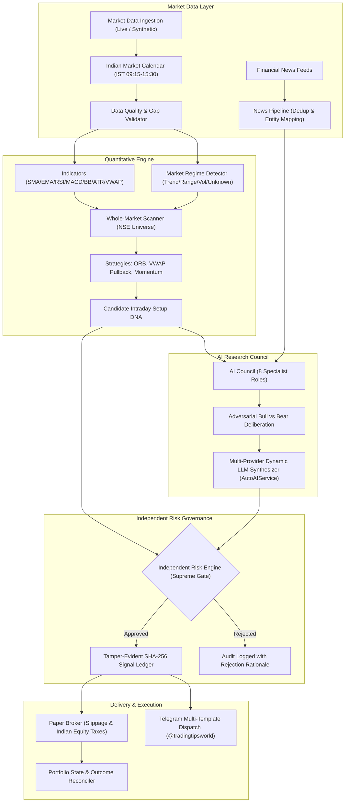

# System Architecture Document — AI Intraday Market Intelligence Platform
**Platform:** `indian-markets-quant-research`  
**Target Markets:** Indian Equities (NSE/BSE Cash Intraday)  
**Architecture Pattern:** Clean-Room Modular Monolith  
**Last Updated:** 2026-10-22  

---

## 1. High-Level Architecture Overview

The platform is engineered as an evidence-first quantitative market-intelligence system that scans the market, detects regimes, interprets news, evaluates intraday setups, independently validates risk, cryptographically records every signal, and broadcasts actionable templates to Telegram.

---

## 2. Core Subsystems and Module Contracts

### 2.1 Market Data & Ingestion (`app/data/`)
- **`interfaces.py`**: `MarketDataProvider` abstract base class, `Instrument`, `OHLCVBar`, `DataQualityReport`.
- **`session.py`**: `IndianMarketCalendar` managing Asia/Kolkata (IST) market phases (Pre-open 09:00, Regular 09:15-15:30, Post-close), trading holidays, and weekend filters.
- **`validation.py`**: Validates chronological monotonicity, detect time gaps, boundary integrity (high >= low), zero/negative prices, and volume anomalies.
- **`news.py`**: `NewsPipeline` with normalized hashing deduplication, NSE company entity mapping, and prompt injection sanitization.
- **`providers/synthetic.py`**: Deterministic synthetic random-walk generator for offline development and testing.

### 2.2 Quantitative Research & Scanning (`app/quant/`)
- **`regime.py`**: `MarketRegimeDetector` categorizing market into `TRENDING_BULLISH`, `TRENDING_BEARISH`, `RANGE_BOUND`, `HIGH_VOLATILITY`, `LOW_VOLATILITY`, or `UNKNOWN`.
- **`scanner.py`**: `WholeMarketScanner` evaluating a configurable liquid NSE universe. Formulates `IntradaySetupRecord` (Setup DNA: trigger, invalidation, R:R, estimated statutory costs). Supports the explicit outcome **"No sufficiently strong setup today"**.
- **`strategies/`**:
  - `OpeningRangeBreakoutStrategy`: 15m/30m session breakout with volume confirmation.
  - `VWAPPullbackStrategy`: Trend-following test and bounce from intraday VWAP.
  - `SMACrossoverStrategy`: Reference trend benchmark strategy.

### 2.3 AI Research Council (`app/agents/`)
- **`ai_service.py`**: `AutoAIService` providing dynamic live model discovery across Groq, Gemini (primary & backup), Mistral, NVIDIA NIM, and OpenRouter with automatic deprecation cascading.
- **`orchestration.py`**: `AgentCouncilOrchestrator` managing the 8 specialist agents with adversarial debate preservation.
- **`schemas.py`**: Strict Pydantic contracts for all agent outputs.

### 2.4 Independent Risk Governance (`app/risk/`)
- **`engine.py`**: `RiskEngine` operating as supreme authority independent of AI confidence. Enforces max position size (<=10%), portfolio exposure (<=80%), maximum drawdown (<=20%), cash sufficiency, and an instant kill switch.

### 2.5 Backtesting & Paper Execution (`app/backtesting/` & `app/portfolio/`)
- **`engine.py`**: `BacktestEngine` with sequential anti-lookahead event processing and point-in-time calculation.
- **`manager.py`**: `PortfolioManager` and `PaperBroker` with realistic Indian statutory equity intraday transaction cost modeling (STT 0.025%, ₹20 brokerage cap, Stamp Duty 0.003%, GST 18%, SEBI fees).

### 2.6 Cryptographic Audit Ledger (`app/audit/`)
- **`ledger.py`**: `TamperEvidentSignalLedger` maintaining an append-only, SHA-256 chained record of every setup, AI evaluation, risk check, Telegram message ID, and subsequent market outcome (Triggered, Invalidated, Expired, Won, Lost, No-Trade).

### 2.7 Delivery & Notifications (`app/notifications/`)
- **`telegram.py`**: `TelegramNotificationProvider` for Telegram Bot API delivery with message chunking and markdown parsing.
- **`templates.py`**: `TelegramTemplates` generating structured mobile messages for Regime Briefings, Setup DNA, Activations, Invalidation warnings, No-Trade notices, and Transparent Scorecards.
