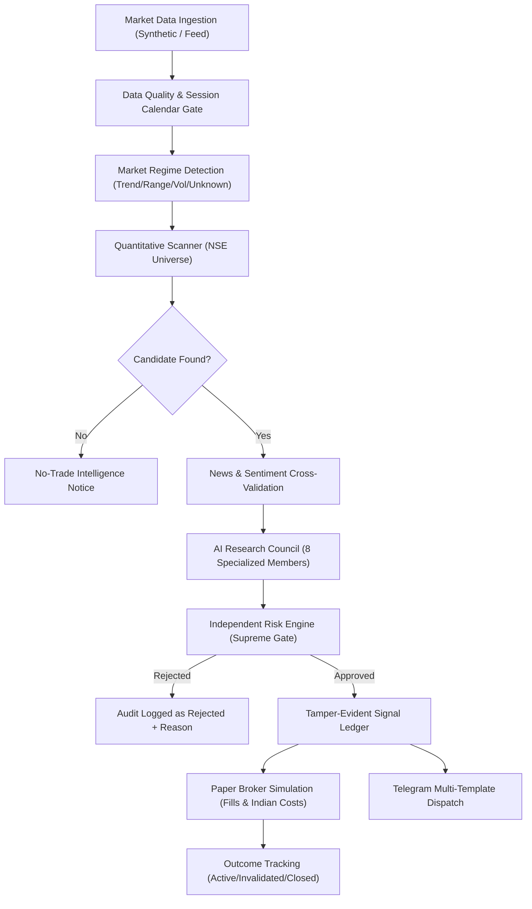

# BASELINE REPOSITORY AUDIT REPORT
**Target Platform:** AI Intraday Market Intelligence Platform (`indian-markets-quant-research`)  
**Audit Date:** 2026-10-22  
**Auditor:** Quantitative Trading & Systems Security Engineering  
**Branch:** `main` | **Working Tree:** Clean  
**Test Suite Status:** 28 passed in 3.09s (pytest 9.1.1, Python 3.14 on Windows 11)

---

## 1. Executive Summary

An exhaustive code audit was performed across all directories of the `tradingtipsworld/indian-markets-quant-research` repository. The existing codebase provides an initial modular foundation with clean separation between data, quant, risk, portfolio, AI agents, reporting, and FastAPI routing. However, multiple structural enhancements are required to transform it into a production-grade Indian intraday market-intelligence engine.

---

## 2. Inventory of Existing Modules & Real Execution Status

| Subsystem | Existing Path | Verified State | Actual Implementation vs Mock | Production Gaps Identified |
| :--- | :--- | :---: | :--- | :--- |
| **Data Layer** | `app/data/` | Functional | `SyntheticDataProvider` generates deterministic random-walk OHLCV bars. `validate_ohlcv` performs basic checks. | Missing market session calendar (IST 09:15-15:30), timestamp gap/frequency detection, live tick schema, and news ingestion models. |
| **Quant Engine** | `app/quant/` | Functional | Basic indicators (SMA, EMA, RSI, MACD, Bollinger Bands) and single strategy `SMACrossoverStrategy`. | Missing market-regime classification (trending, range, high/low vol, unknown), scanner for NSE universe, and intraday strategies (ORB, VWAP pullback, relative strength). |
| **AI Agents** | `app/agents/` | Functional | 8-member council (`AgentCouncilOrchestrator`) and multi-provider auto-model fallback client (`AutoAIService`). | Agents were previously calling hardcoded rule functions rather than integrating `AutoAIService`. Missing structured prompt templates with anti-hallucination guards. |
| **Risk Engine** | `app/risk/` | Functional | `RiskEngine` with drawdown, exposure, position size, and kill-switch checks. | Risk engine was evaluated only in backtesting/portfolio, not yet as an independent gate for candidate scanner alerts. |
| **Backtesting** | `app/backtesting/` | Functional | Sequential anti-lookahead backtest engine with `TransactionCostModel`. | Costs used generic percentages rather than exact statutory Indian intraday equity charges (STT, NSE turnover, SEBI fee, Stamp duty, GST). |
| **Paper Broker** | `app/portfolio/` | Functional | `PaperBroker` and `PortfolioManager` with in-memory execution and slippage modeling. | State resets on restart unless persisted to database; needs integration with tamper-evident audit ledger. |
| **Persistence** | `app/db/` | Functional | SQLAlchemy models for instruments, orders, and audit logs. | Missing tables for scanned intraday setups, market regimes, news items, and Telegram delivery records. |
| **Notifications**| `app/notifications/`| Functional | `TelegramNotificationProvider` with markdown formatting and chunking. | Missing specific intraday templates (regime notice, setup activated, invalidated, no-trade notice, transparent scorecard). |
| **Audit Trail** | `app/audit/` | Functional | In-memory `AuditTrailLogger`. | Needs cryptographic or tamper-evident signal linkage connecting raw market data -> quant setup -> AI review -> risk decision -> Telegram message ID. |

---

## 3. Baseline Test Suite Verification

- **Command:** `python -m pytest -v`
- **Results:**
  - `tests/test_agents.py`: 1 passed
  - `tests/test_ai_service_and_telegram.py`: 4 passed
  - `tests/test_api.py`: 4 passed
  - `tests/test_backtest.py`: 1 passed
  - `tests/test_config.py`: 4 passed
  - `tests/test_data_validation.py`: 3 passed
  - `tests/test_indicators.py`: 4 passed
  - `tests/test_portfolio.py`: 3 passed
  - `tests/test_risk.py`: 4 passed
  - **Total:** 28 passed in 3.09s (0 failures, 0 warnings).

---

## 4. End-to-End Workflow Mapping

---

## 5. Security & Operational Boundary Review

1. **Live Broker Connectivity:** Strictly disabled. No live execution broker adapter exists.
2. **Secret Safety:** No credentials hardcoded. Verified NaCl encryption in GitHub Actions Secrets and local `.gitignore` protection for `.env`.
3. **Data Integrity:** Synthetic data is explicitly labeled and separated. No synthetic data will masquerade as live market ticks.
