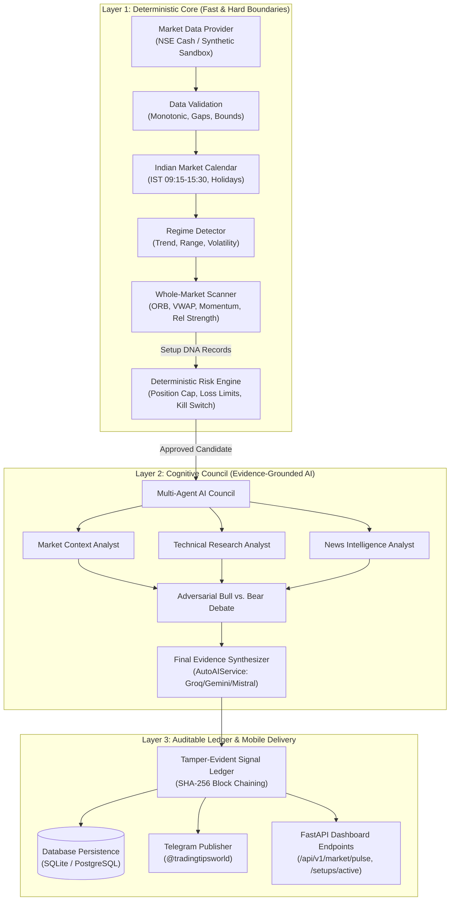

# ARCHITECTURE COMPARISON & SUBSYSTEM DEEP-DIVE
**Project:** `indian-markets-quant-research`  
**Date:** 2026-10-22  
**Target Environment:** Python 3.11+, Windows 11 / Linux, FastAPI, Pydantic v2  

---

## 1. Architectural Overview & Structural Comparison

Modern algorithmic research and trading systems fall into three broad archetypes:
1. **Rule-Based Execution Bots (e.g. Freqtrade, Hummingbot):** Focused on low-latency tick processing, state machines, and direct exchange connectivity. Strong execution discipline, but lacks qualitative macro context or adaptive news synthesis.
2. **Heavy Institutional Engines (e.g. QuantConnect LEAN):** Multi-tiered, highly structured C#/.NET enterprise platforms with comprehensive transaction cost models and portfolio accounting. Extremely robust, but heavyweight and complex to extend for real-time AI multi-agent synthesis.
3. **Multi-Agent AI Deliberation Frameworks (e.g. TradingAgents, AI Hedge Fund):** Emergent LLM-centric systems focusing on multi-agent debate and reasoning. High semantic reasoning, but prone to hallucinations, look-ahead bias, token latency, and lacking deterministic risk barriers.

### Our Hybrid Institutional Architecture
Our platform bridges these worlds by implementing a **Strict 3-Tier Layered Architecture**:
- **Layer 1 (Deterministic Core):** Data validation, Indian market calendar, quantitative indicators, whole-market scanner, and hard risk gating. 100% deterministic, zero LLM dependency.
- **Layer 2 (Cognitive Council):** Multi-agent AI deliberation with live multi-provider fallback (Groq, Gemini, Mistral, OpenRouter, NVIDIA NIM), adversarial Bull/Bear debate, and strict evidence grounding.
- **Layer 3 (Tamper-Evident Ledger & Dissemination):** SHA-256 cryptographically chained audit blocks, database persistence, and mobile-optimized Telegram dispatch.



---

## 2. Subsystem Comparative Breakdown

### A. Market Data & Session Synchronization
| Feature / Subsystem | Freqtrade | QuantConnect LEAN | OpenBB | Our Architecture |
| :--- | :--- | :--- | :--- | :--- |
| **Timezone Management** | UTC fixed | Exchange-aware via timezone databases | UTC / local client | Explicit `Asia/Kolkata` IST enforcement |
| **Market Calendar** | 24/7 Crypto continuous | Global equity/futures calendar | Vendor-dependent | `IndianMarketCalendar` (09:15-15:30 IST, Pre-open 09:00, NSE Holidays) |
| **Data Validation** | Basic candle gaps check | Multi-tier validation & exchange tick rules | Schema normalization | Strict monotonic timestamp check, high $\ge$ low, volume consistency, gap warnings |
| **Provenance Labeling** | Unlabeled dataframes | Strict `Security` & `SubscriptionDataConfig` | Provider metadata | `DataProvenance` contract: provider, mode (Live/Delayed/Synthetic), exchange, timeframe |

### B. Whole-Market Scanning & Opportunity Discovery
| Feature / Subsystem | TradingAgents | Freqtrade | VectorBT | Our Architecture |
| :--- | :--- | :--- | :--- | :--- |
| **Universe Scope** | Single ticker prompt | Configurable pair list | Arbitrary multi-asset matrix | Configurable liquid NSE universe (15+ core stocks + sectors) |
| **Strategy Families** | LLM general reasoning | Declarative single strategy per bot | Broadcasted vector logic | Multi-strategy pool: ORB (15m/30m), VWAP Pullback, Momentum Breakout, Relative Strength |
| **Risk/Reward Filter** | Arbitrary prompt opinion | Static stop-loss & ROI table | Computed ex-post | Deterministic minimum 1:1.5 threshold; setups $< 1.5$ rejected |
| **No-Trade State** | Hallucinates an opinion | Idle cycle (no signals) | Empty output slice | Explicit structured **"No-Trade Notice"** with regime justification |

### C. AI Multi-Agent Deliberation & Evidence Grounding
| Feature / Subsystem | TradingAgents | AI Hedge Fund | Our Architecture |
| :--- | :--- | :--- | :--- |
| **Agent Roles** | 6 agents (LangGraph) | 5 persona agents | 7 institutional roles: Context, Technical, News, Bull, Bear, Risk, Synthesizer |
| **Provider Resilience** | Single provider (OpenAI) | Single provider (OpenAI) | **AutoAIService:** Dynamic fallback across Groq, Gemini, Mistral, NVIDIA NIM, OpenRouter |
| **Prompt Injection Defense**| Minimal | Minimal | Multi-stage regex sanitization stripping control delimiters and instruction injection |
| **Grounding Enforcement** | Prompt instruction | JSON schema | Mathematical isolation: All price numbers, indicators, and bounds computed deterministically |

### D. Transaction Cost & Execution Friction
| Feature / Subsystem | Freqtrade | VectorBT | QuantConnect LEAN | Our Architecture |
| :--- | :--- | :--- | :--- | :--- |
| **Fee Modeling** | Flat exchange maker/taker % | Flat bps fee | Institutional custom fee models | Statutory Indian equity fee model (`TransactionCostModel`) |
| **Indian Taxes Included**| None | None | NSE fee handler available | STT (0.025% sell-side), Brokerage cap (min ₹20), Stamp Duty (0.003%), Turnover fee, 18% GST |
| **Slippage Modeling** | Simulated tick slippage | Linear slippage array | Volume-share & tick spread slippage | Configurable percentage slippage model with liquidity boundary checks |

### E. Risk Controls & Circuit Breakers
| Feature / Subsystem | TradingAgents | Freqtrade | QuantConnect LEAN | Our Architecture |
| :--- | :--- | :--- | :--- | :--- |
| **Authority** | LLM recommendation | Deterministic `PairLock` | Deterministic `IRiskManagementModel` | Independent deterministic `RiskEngine` overrides AI unconditionally |
| **Position Sizing** | Fixed or LLM opinion | Static stake amount / dynamic compounding | Portfolio percentage / target risk | Max position % of cash, max portfolio exposure %, concentration caps |
| **Hard Kill-Switch** | None | Stop command via Telegram | Emergency algorithm stop | Global programmatic `kill_switch` freezing all order placements and setup approvals |

### F. Verification, Persistence & Signal Ledger
| Feature / Subsystem | Freqtrade | AI Hedge Fund | Our Architecture |
| :--- | :--- | :--- | :--- |
| **Signal Audit Trail** | SQLite order database | Unpersisted logs | `TamperEvidentSignalLedger`: SHA-256 block-hash chained ledger |
| **Tamper Detection** | Database level only | None | Cryptographic integrity verification (`verify_integrity()`) detecting retroactive edits |
| **Outcome Tracking** | Trade close records | None | Full lifecycle: Candidate -> Approved -> Triggered -> Invalidated -> Expired -> Won/Lost |
| **Database Persistence** | SQLite / PostgreSQL | In-memory | Multi-backend SQLAlchemy async models (`SetupRecordModel`, `LedgerBlockModel`, `DailySnapshotModel`) |

### G. Mobile Telegram Communication
| Feature / Subsystem | Freqtrade | TradingAgents | Our Architecture |
| :--- | :--- | :--- | :--- |
| **Delivery Medium** | Telegram Bot RPC | Terminal / CLI only | Telegram Channel & Group Broadcasting |
| **Formatting** | Text & charts | Unformatted text | Standardized Telegram mobile cards with monospace code blocks, emojis, and bilingual Hindi/English tone |
| **Resilience** | HTTP polling | N/A | Markdown v2 safe escaping, automatic 4096-char chunking, backoff retries |

---

## 3. Detailed Subsystem Data Flows

### A. Intraday Setup DNA Flow
```text
Raw Ticker Ingestion -> Validation (Monotonic, High>=Low)
  -> Regime Classification (e.g. Bullish Trend, Range)
  -> Strategy Trigger Evaluation (e.g. ORB Breakout above 15m high)
  -> Transaction Cost & Invalidation Calculation (STT, Brokerage, Stop-loss)
  -> Risk Engine Sizing Check (Portfolio Exposure, Concentration)
  -> Setup DNA Generated (Candidate)
```

### B. Council Debate & Cryptographic Anchoring Flow
```text
Candidate Setup DNA
  -> Multi-Agent Prompt Construction (Injecting deterministic metrics only)
  -> Bull Case Analysis (Upside catalysts, sector tailwinds)
  -> Bear Case Analysis (Resistance clusters, invalidation vulnerabilities)
  -> Multi-Provider LLM Synthesis (Groq / Gemini / Mistral fallback)
  -> Tamper-Evident SHA-256 Chaining (Block hash = H(Entry + Stop + PrevHash))
  -> Database Commit (LedgerBlockModel)
  -> Telegram Channel Broadcast
```
